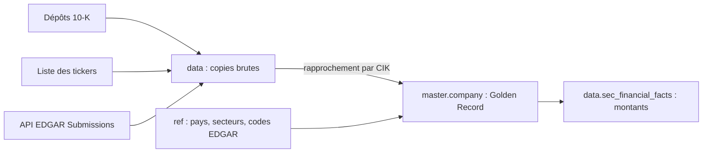

# multi-agent-ai-governance

**MDM d'entreprise sur données publiques de la SEC : une fiche de référence unique, le Golden Record, par entreprise.** 8 485 fiches, 3 sources rapprochées par identifiant officiel, la source de chaque attribut tracée, le tout catalogué dans OpenMetadata.

C'est la première brique d'une plateforme de gouvernance pour agents IA. Projet de groupe HESTIM, cours de Data Governance, encadré par la Pr. N. Daoudi.

## Le problème métier

*Cas d'usage (scénario pédagogique) : une société financière veut un référentiel unique pour ses équipes Finance, Investment et RH, afin que ses futurs agents IA travaillent sur des données fiables. Les données Finance sont réelles et publiques.*

Sans référentiel, chaque équipe garde sa propre liste d'entreprises, et ces listes ne concordent pas :

- **Les noms divergent.** Une même entreprise s'appelle LendingClub dans un dépôt et Happen dans la liste des tickers. C'est le cas de 117 entreprises.
- **Les informations manquent.** Avec les seuls rapports annuels, le pays n'est connu que pour 49 % des entreprises.
- **Les formats trompent.** `14846` et `0000014846` désignent le même identifiant, mais une comparaison directe y verrait deux entreprises.

Un agent IA répond avec la même assurance, que sa donnée soit juste ou fausse. Il faut donc décider quelle version fait autorité avant de lui donner accès.

## Ce que livre le MDM Finance

| Mesure | Résultat | Seuil |
|---|---|---|
| Entreprises dans `master.company` | 8 485, une ligne par CIK, 0 doublon | |
| Sources rapprochées | 3 | au moins 2 |
| Nom renseigné | 100 % | 95 % |
| Pays renseigné | 98,81 %, contre 49 % sans EDGAR | 95 % |
| Secteur renseigné | 85,69 % : **sous le seuil**, voir les points ouverts | 95 % |
| Montants reliés à une entreprise | 63 937, 0 orphelin | |
| Doublons de montants | 5, soit 0,01 % | 1 % |

## Sources et architecture

| Source | Volume | Apporte |
|---|---|---|
| Dépôts 10-K de la SEC (`sub.txt`, `num.txt`, 2026q1) | 4 262 dépôts, 64 253 lignes de montants | nom au moment du dépôt, pays, secteur, montants |
| Liste des tickers de la SEC | 10 423 lignes, 8 017 CIK | nom actuel |
| API EDGAR Submissions | 4 224 fiches | pays et secteur des entreprises sans 10-K dans le trimestre |



- **`data`** : les copies brutes, jamais corrigées, et les transactions.
- **`master`** : les Golden Records, construits par nos règles.
- **`ref`** : les listes de codes qui servent à valider et à traduire les valeurs.

## Règles de survivance

Pour chaque attribut, la source la plus fiable l'emporte. La colonne `*_source` garde la trace de la source gagnante, ce qui donne un lignage par attribut.

| Attribut | Priorité | Pourquoi | Trace |
|---|---|---|---|
| Nom | tickers, puis 10-K, puis EDGAR | le 10-K fige le nom au moment du dépôt, alors que la liste donne le nom actuel | `name_source` |
| Pays | 10-K, puis EDGAR traduit en ISO | déclaration officielle d'abord ; EDGAR utilise ses propres codes (M0 = Japon) | `country_source` |
| Secteur (SIC) | 10-K, puis EDGAR | même logique que le pays | `sic_source` |

Le rapprochement est déterministe : le CIK, l'identifiant officiel de la SEC, est mis sur 10 chiffres puis sert de clé métier. Il est plus sûr qu'un rapprochement sur le nom, qui change dans le temps.

## Gouvernance

- **Data Owner** : Direction Finance. **Data Steward** : Junior.
- **Catalogue OpenMetadata** : descriptions, classification, glossaire et lignage entre les tables.
- **Dictionnaire de données** : [docs/dictionnaire/sec_financial_statements.md](docs/dictionnaire/sec_financial_statements.md).
- **Classification** : les données brutes de la SEC sont `Public · Low`. `master.company`, construit par nos règles, est `Internal · Low`.
- **Contrôles qualité** : [sql/12_finance_quality.sql](sql/12_finance_quality.sql).

## Qualité et points ouverts

- **Secteur sous le seuil** : 1 214 entreprises n'ont pas de code SIC, dont 1 035 de type `other` à la SEC. Décision à prendre.
- **Code `0000`** : reçu d'EDGAR pour 11 entreprises. Il ne désigne aucun secteur, mais compte pour l'instant comme renseigné.
- **Libellés SIC** : 47 codes restent sans libellé, soit 104 entreprises.

## Feuille de route

- **Partie 1, jusqu'au MDM** : les données, les catalogues et les 3 MDM.
- **Partie 2, en cours** : une Governance Engine qui répondra ALLOW ou DENY à chaque demande d'accès et tracera chaque décision, puis les agents IA Finance, Investment et RH, qui passeront par elle pour accéder aux données.

## Équipe

| Membre | MDM | Réalisation | Détail |
|---|---|---|---|
| Junior Gatsoundou | Finance, Tiers et Structures | `master.company` : 8 485 entreprises | [branche `finance`](https://github.com/gatsoundoujuniior-netizen/multi-agent-ai-governance/tree/finance) |
| Ivan Ake Mobio | Investment, Produits | `master.security` : 503 titres, 2 948 439 cours reliés | [branche `investment`](https://github.com/gatsoundoujuniior-netizen/multi-agent-ai-governance/tree/investment) |
| Mohamed Traoré | RH, Ressources humaines | `master.employee` : 1 470 employés | [branche `hr`](https://github.com/gatsoundoujuniior-netizen/multi-agent-ai-governance/tree/hr) |

Pour réaliser ou comprendre un MDM, voir le [guide d'équipe](docs/guide/GUIDE_MDM.md).

## Lancer le projet

Prérequis : Docker, Python et les datasets SEC dans `data/raw/sec/`.

```powershell
copy .env.example .env
docker compose up -d --wait                                            # PostgreSQL (port 5433)
docker compose -f openmetadata/docker-compose.yml up --detach --wait   # OpenMetadata (port 8585)
```

OpenMetadata est sur http://localhost:8585 (admin@open-metadata.org / admin, à changer au premier accès).

Reconstruire le MDM Finance, dans cet ordre :

```powershell
python scripts/load_sec.py                      # dépôts 10-K, montants, plan de comptes, tickers
python scripts/load_sec_submissions.py          # fiches EDGAR, avec reprise possible
docker exec gouv_postgres psql -U gouv -d governance -v ON_ERROR_STOP=1 -f /sql/11_finance_mdm.sql
docker exec gouv_postgres psql -U gouv -d governance -f /sql/12_finance_quality.sql
python scripts/setup_openmetadata.py            # configuration commune et ingestion
python scripts/enrich_openmetadata_finance.py   # catalogue, dictionnaire, glossaire, lignage
```

## Conventions communes

| Sujet | Valeur |
|---|---|
| Schémas | `ref`, `master`, `data`, `gov` |
| Tables brutes | `data.<dataset>_raw` |
| Agents | `finance_agent`, `investment_agent`, `hr_agent` |
| Datasets | `sec_financial_statements`, `sp500_market_data`, `ibm_hr_analytics` |
| Classification | `Public`, `Internal`, `Confidential`, `Restricted` |
| Sensibilité | `Low`, `Medium`, `High` |
| Purposes valides | `valuation`, `reporting`, `audit` |
| Seuil qualité | 95 % de complétude, 1 % de doublons maximum |
| Branches | `finance`, `investment`, `hr` (PR relue par un autre membre) |

## Contrats entre membres

| Table | Propriétaire | Utilisée par | Colonnes stables |
|---|---|---|---|
| `master.company` | Finance | Investment (lien ticker vers entreprise) | `company_id`, `cik` (10 chiffres), `legal_name`, `country`, `sic_code` |
| `ref.currency`, `ref.country` | Finance | Tous | `code`, `label` |
| `ref.sector` (GICS) | Investment | Tous | `sector_id`, `label` |

`master.company` contient une ligne par CIK. `country` et `sic_code` peuvent être vides. Les colonnes `name_source`, `country_source`, `sic_source` et `updated_at` servent à la traçabilité et ne font pas partie du contrat. `ref.sic` et `ref.edgar_location` sont internes au MDM Finance.

## Arborescence

```
docker-compose.yml       PostgreSQL du projet
openmetadata/            quickstart OpenMetadata 2.0.1 (fichier officiel)
sql/init/                exécuté une seule fois à la création de la base
sql/                     scripts par membre : 1x finance, 2x investment, 3x hr
scripts/                 exploration et chargement des datasets
data/raw/                datasets téléchargés (jamais dans Git)
data/seed/               petites tables simulées (dans Git)
docs/guide/              guide d'équipe pour réaliser son MDM
docs/dictionnaire/       fiches catalogue et dictionnaires de données
docs/cours/              énoncés de TP et PDF
policies/                règles d'accès en JSON (partie 2)
governance_engine/       API FastAPI, le portier (partie 2)
agents/                  agents LangGraph (partie 2)
dashboard/               Streamlit (partie 2)
tests/                   pytest (partie 2)
```

## Annexe : énoncés de TP

Les énoncés du cours sont dans [docs/cours/](docs/cours/) : [TP0 commun](docs/cours/TP0_Commun_Fondations.md), [TP1 Finance](docs/cours/TP1_Finance_MDM_Tiers_Structures.md), [TP2 Investment](docs/cours/TP2_Investment_MDM_Produits.md) et [TP3 RH](docs/cours/TP3_HR_MDM_Ressources.md).
